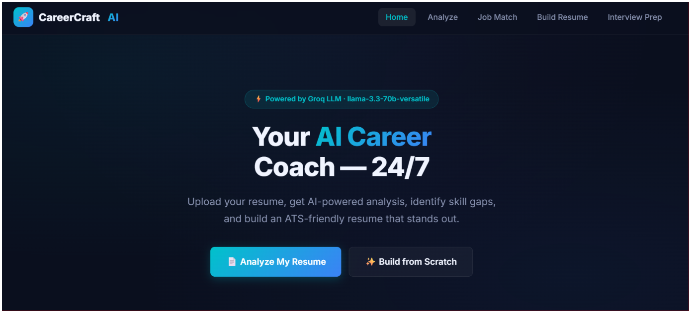
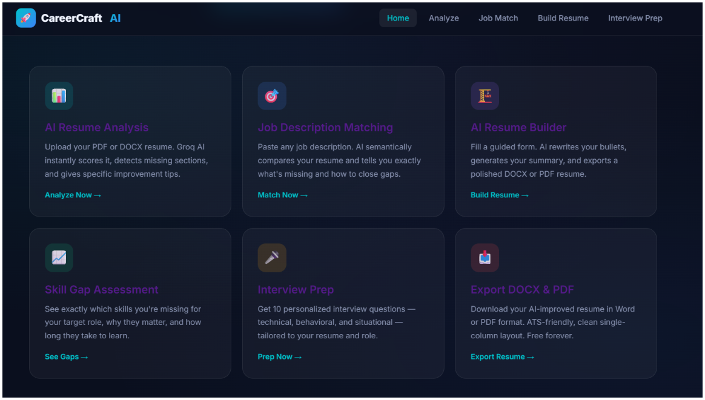
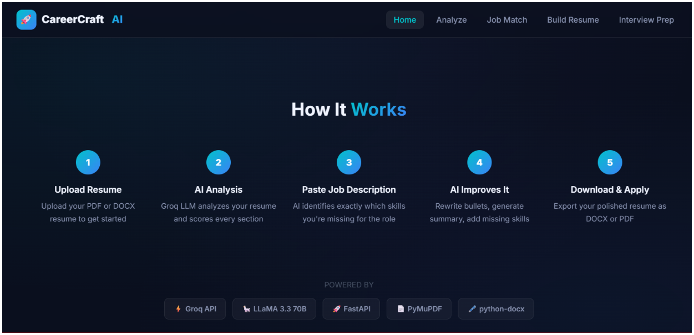

# CareerCraft AI

**Your AI career coach, 24/7.** Upload a resume, get an AI-powered analysis, find the skills you are missing for a target role, generate a tailored ATS-friendly resume, and practice with personalized interview questions.

CareerCraft AI is built with a **FastAPI** backend, a static **HTML/CSS/JavaScript** frontend, and **Groq** (`llama-3.3-70b-versatile`) for resume analysis and writing assistance.




---

## Table of Contents

- [Features](#features)
- [How It Works](#how-it-works)
- [Screenshots](#screenshots)
- [Tech Stack](#tech-stack)
- [Getting Started](#getting-started)
- [Running the App](#running-the-app)
- [Deploy on Render](#deploy-on-render)
- [API Endpoints](#api-endpoints)
- [Project Structure](#project-structure)
- [Privacy and Responsible Use](#privacy-and-responsible-use)
- [Known Limitations](#known-limitations)
- [Roadmap](#roadmap)
- [Author](#author)

---

## Features

| Feature | What it does |
|---|---|
| **AI Resume Analysis** | Upload a PDF or DOCX resume. The app extracts the text, scores it out of 100, detects the skills it finds, lists strengths, flags missing sections, and gives specific improvement tips. |
| **Job Description Matching** | Paste any job description. The AI compares it with your resume and returns a match score, matched skills, missing skills, and bonus skills you already have. |
| **Skill Gap Assessment** | Every missing skill comes with a priority (critical or important), an estimated time to learn, why it matters for the role, and a concrete first step. |
| **Resume Tailoring Tips** | Section-by-section advice (summary, technical skills, experience, projects, certifications) on how to adapt the resume to the job. |
| **AI Resume Builder** | Upload your existing resume plus a job description and get a tailored resume. Your original resume is the source of truth: the AI rewrites wording for the job without adding unsupported experience or skills. |
| **Edit and Export** | Review and edit the generated content, then download it as **DOCX** or **PDF** in a clean single-column, ATS-friendly layout. |
| **Interview Prep** | Generates 10 personalized questions (technical, behavioral, situational) based on your resume and an optional job description, plus an overall interview strategy. |
| **Builder helpers** | Generate a professional summary, rewrite a single bullet point, suggest skills for a role, or improve a whole section. |

### Analysis score breakdown

The resume score is made of five categories, each out of 20:

| Category | Max |
|---|---|
| Contact Info | 20 |
| Sections | 20 |
| Skills Depth | 20 |
| Content Quality | 20 |
| Readability | 20 |

---

## How It Works

1. **Upload resume.** Provide a PDF or DOCX file.
2. **AI analysis.** Groq analyzes the resume and scores every section.
3. **Paste job description.** The AI identifies exactly which skills you are missing for the role.
4. **AI improves it.** Bullets are rewritten, a summary is generated, and relevant skills are surfaced.
5. **Download and apply.** Export the polished resume as DOCX or PDF.

The resume from your last analysis is carried over automatically to the Job Match page, so you do not have to paste it again.

---

## Screenshots

### Home






---

## Tech Stack

| Layer | Technology |
|---|---|
| LLM | Groq API, Llama 3.3 70B (`llama-3.3-70b-versatile`) |
| Backend | Python 3.11+, FastAPI, Uvicorn |
| Resume parsing | PyMuPDF (PDF), python-docx (DOCX) |
| Document export | DOCX and PDF generation (`backend/core`) |
| Frontend | Static HTML, CSS, and vanilla JavaScript served by FastAPI |
| Deployment | Render (single web service) |

---

## Getting Started

### Requirements

- Python 3.11 or newer
- A [Groq API key](https://console.groq.com/)

### 1. Clone the repository

```bash
git clone https://github.com/Sunaina792/CareerCreaft-AI.git
cd CareerCreaft-AI
```

### 2. Create and activate a virtual environment

**Windows (PowerShell)**

```powershell
py -3.11 -m venv .venv
.\.venv\Scripts\Activate.ps1
```

If PowerShell blocks the activation script, run `Set-ExecutionPolicy -Scope CurrentUser RemoteSigned` once and try again.

**macOS / Linux**

```bash
python3.11 -m venv .venv
source .venv/bin/activate
```

### 3. Install dependencies

```bash
python -m pip install -e .
```

### 4. Configure environment variables

Create the root `.env` file from the example.

**Windows (PowerShell)**

```powershell
Copy-Item .env.example .env
```

**macOS / Linux**

```bash
cp .env.example .env
```

Open `.env` and set your Groq API key:

```env
GROQ_API_KEY=your_groq_api_key_here
```

> Keep the real API key private. Do not commit `.env` files; they are excluded by `.gitignore`. Never put the key in frontend code.

---

## Running the App

From the project directory, with the virtual environment activated:

```bash
python -m uvicorn backend.main:app --host 127.0.0.1 --port 8000 --reload
```

| URL | What you get |
|---|---|
| http://localhost:8000 | The web app |
| http://localhost:8000/docs | Interactive API documentation |
| http://localhost:8000/api/health | Health check |

---

## API Endpoints

All application endpoints are served under `/api`.

| Method | Endpoint | Purpose |
|---|---|---|
| `GET` | `/api/health` | Check that the server is running |
| `POST` | `/api/analyze` | Upload a PDF or DOCX resume for analysis |
| `POST` | `/api/match` | Compare resume text with a job description |
| `POST` | `/api/builder/summary` | Generate a professional summary |
| `POST` | `/api/builder/rewrite-bullet` | Rewrite a resume bullet point |
| `POST` | `/api/builder/suggest-skills` | Suggest skills for a target role |
| `POST` | `/api/builder/improve-section` | Improve resume section content |
| `POST` | `/api/builder/tailor` | Tailor an uploaded PDF or DOCX resume to a job description |
| `POST` | `/api/interview-prep` | Generate interview questions and tips |
| `POST` | `/api/export` | Generate a DOCX or PDF resume |

Interactive request schemas and responses are available at `/docs` while the server is running.

---

## Project Structure

```text
CareerCraft_AI/
├── backend/
│   ├── core/        Resume parsing, Groq integration, prompts, and document export
│   ├── routers/     FastAPI endpoint modules
│   └── main.py      Application entry point and frontend hosting
├── frontend/        HTML pages, stylesheets, and browser-side JavaScript
├── screenshots/ Images used in this README
├── .env.example     Template for environment variables
└── pyproject.toml   Project metadata and dependencies
```

---

## Privacy and Responsible Use

- Uploaded resumes are **processed in memory and are not stored** by the app.
- Resume text is sent to the Groq API to generate results, so avoid uploading documents with information you do not want shared with a third-party AI provider.
- The tailoring feature is designed to treat your original resume as the source of truth and not invent skills or experience. **Always review the generated resume before submitting it** to an employer.

---

## Known Limitations

- Scores and match percentages are produced by a language model, so they are guidance, not an official ATS result, and may vary slightly between runs.
- Resume parsing works best on text-based PDFs and DOCX files. Scanned or image-only PDFs may not extract well.
- The free Groq tier has rate limits, so heavy usage may be throttled.

---

## Roadmap

- [ ] More consistent scoring across runs
- [ ] Multiple resume templates
- [ ] Saved history and user accounts
- [ ] Model answers and STAR-format hints for interview questions
- [ ] Automated test suite for the API and export modules

---

## Author

**Sunaina**, 

- GitHub: [@Sunaina792](https://github.com/Sunaina792)
- LinkedIn: [sunaina-ai](https://linkedin.com/in/sunaina-ai)


